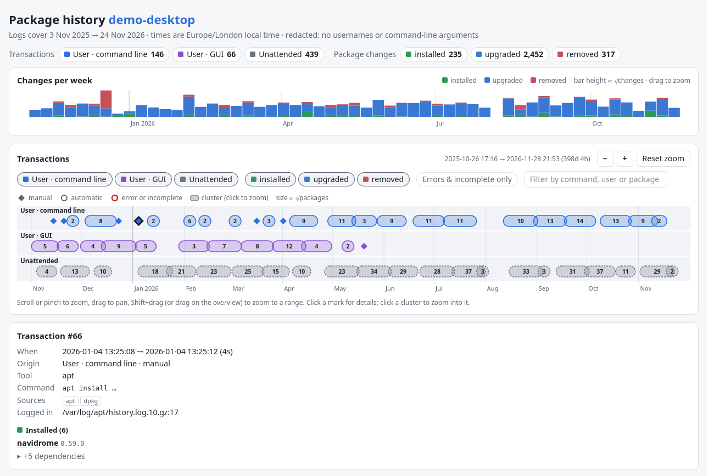

# Apt History Viewer

`apt-history-viewer` turns a Debian or Ubuntu machine's apt and dpkg logs into an
interactive HTML report. The report shows every package install, upgrade and removal on a
timeline, and marks whether a person did it (apt, apt-get, aptitude or Synaptic) or it
happened automatically (unattended-upgrades, scripts run as root, bare dpkg).

It is a single static binary with no runtime dependencies. The report is a single HTML
file with nothing to fetch, so it can be opened offline, mailed or attached to a ticket.



## What the report shows

* **Overview:** changes per day, week or month, split into installs, upgrades and removals.
  Drag across it to zoom the timeline to that range.
* **Timeline:** one lane per origin (person at a terminal, person in a GUI, unattended
  upgrades, root scripts, dpkg run directly). Each transaction is a mark, sized by how many
  packages it changed and outlined in red if it failed or was left incomplete. Nearby marks
  are grouped into clusters until you zoom in. Scroll or pinch to zoom, drag to pan, and
  Shift+drag to zoom to a range.
* **Details:** click a mark to see when it ran, the command line, who asked for it, and
  every package it changed, with versions. Packages pulled in as dependencies are listed
  separately from the ones that were asked for.
* **Filters:** show only some origins or change types, only errors and incomplete runs,
  or only transactions whose command, user or packages match some text.
* **Package history:** search for any package (e.g. `firefox` or `libc6:i386`) to see each
  version it has had, when it was installed, and whether it is marked as manually or
  automatically installed now.
* **Transactions table:** everything in the current view, sortable by any column.

Times are shown in the machine's own local time, as written in its logs. The page follows
your system's light or dark setting.

## Requirements

* **To run:** Linux on amd64 or arm64. Nothing else. It doesn't need root: on Debian and
  Ubuntu, `/var/log/apt/history.log` and `/var/log/dpkg.log` are readable by everyone.
* **To view:** any current browser with JavaScript enabled.
* **To build:** Go 1.27 or later. Node.js is optional; if installed, the tests also run
  the report's JavaScript tests.

## Installation

Download the binary for your architecture from the releases page, check it against
`SHA256SUMS`, and put it on your `PATH`:

```sh
sha256sum -c --ignore-missing SHA256SUMS
install -m 755 apt-history-viewer-*-linux-amd64 ~/.local/bin/apt-history-viewer
```

Or build it from source:

```sh
make build       # ./apt-history-viewer for this machine
make release     # dist/: static linux-amd64 and linux-arm64 binaries + SHA256SUMS
```

`make test` runs the tests and `make check` also fuzzes the log parsers for a short while.

## Usage

Make a report for this machine and open it:

```sh
apt-history-viewer --open
```

This writes `apt-history-<host>.html` in the current directory. Use `-o` to choose another
name.

### Reports for other machines

Collect the logs on the other machine:

```sh
tar czf myhost-pkglogs.tgz /var/log/apt/history.log* /var/log/dpkg.log* \
    /var/log/aptitude* /var/lib/dpkg/status /var/lib/apt/extended_states \
    /etc/hostname /etc/timezone
```

Then copy the tarball over and make the report:

```sh
apt-history-viewer -i myhost-pkglogs.tgz
```

`-i` also accepts a directory: either a copy of the machine's filesystem layout
(`<dir>/var/log/apt/…`) or a flat directory of the log files. Repeat `-i` to make one
report per input; `-o` is then the directory to write them to. Missing pieces are
fine: without `dpkg/status` the report can't show current versions, and without
`etc/timezone` times are shown exactly as logged.

### Sharing a report

The report contains usernames (from apt's `Requested-By`) and full command lines, which
can include file paths. `--redact` removes them:

* usernames and uids are dropped;
* command lines are cut to the program and subcommand (`apt install …`);
* file paths outside the system directories are cut to their base name, so an input such
  as `/home/alice/box.tgz` appears as `box.tgz`.

Package names and versions are kept. So is the host name; use `--host` to change it.

```sh
apt-history-viewer --redact --host build-server-3 -o report.html
```

### All options

| Option | Meaning |
|---|---|
| `-i`, `--input PATH` | Directory or `.tar`, `.tar.gz`, `.tgz` to read (default `/`; repeatable) |
| `-o`, `--output FILE` | Output file, `-` for stdout, or a directory with several inputs |
| `--open` | Open the report in the default browser (`xdg-open`) once it's written |
| `--redact` | Remove usernames, command-line arguments and private paths |
| `--host NAME` | Host name to show in the report |
| `--apt-dir DIR` | Read `history.log*` from here instead of `<input>/var/log/apt` |
| `--dpkg-log PATH` | Read this dpkg log (and its rotations) instead of `<input>/var/log/dpkg.log` |
| `--dpkg-status PATH` | Read this dpkg status file instead of `<input>/var/lib/dpkg/status` |
| `--json` | Write the correlated report as JSON instead of HTML |
| `--raw` | Write the uncorrelated parse of every log as JSON (for debugging) |
| `--version` | Print the version |

Rotated logs (`history.log.1`, `dpkg.log.2.gz`, …) are found and read automatically.
Lines the parsers can't understand are skipped and listed as warnings on stderr and at
the top of the report. The program exits non-zero only if no log could be read at all.

## How far back it goes

The report can only show what the logs still hold. By default Debian and Ubuntu rotate
apt's history monthly and dpkg's log monthly, keeping about a year of each. Packages that
were installed before the logs begin are marked "present before the logs begin", and
the header shows the dates the logs cover.

## What it doesn't cover

Only apt and dpkg. Snap, Flatpak, pip, and anything installed by hand or with
`make install` don't go through dpkg, so they aren't in these logs.

## How it works

See [DESIGN.md](DESIGN.md) for how the logs are parsed and matched up, and how each
transaction's origin is decided.

## License

Licensed under the GNU General Public License, version 3. See [LICENSE](LICENSE).
